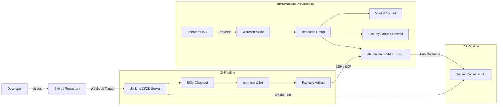

# 🚀 End-to-End Azure & Jenkins CI/CD DevOps Project

An enterprise-ready, automated Infrastructure-as-Code (IaC) and Continuous Integration/Continuous Deployment (CI/CD) project.

---

## 🏗️ Architecture Overview



---

## 🗂️ Project Structure

```
azure-jenkins-devops/
├── terraform/                   # Infrastructure as Code (Azure)
│   ├── provider.tf              # AzureRM provider configuration
│   ├── variables.tf             # Configurable input variables
│   ├── main.tf                  # Resources (RG, VNet, Subnet, NIC, PIP, NSG, VM)
│   ├── outputs.tf               # Exported public IP & connection commands
│   └── terraform.tfvars.example # Example variable definitions
├── app/                         # Production Web Application (Node.js/Express)
│   ├── server.js                # Server logic with /health and /api/info
│   ├── package.json             # App dependencies and scripts
│   ├── Dockerfile               # Production multi-stage Docker build
│   ├── test/
│   │   └── server.test.js       # Automated unit & smoke tests
│   └── public/
│       ├── index.html           # DevOps telemetry dashboard
│       └── style.css            # Responsive dashboard styles
├── jenkins/                     # CI/CD Automation Pipeline
│   ├── Jenkinsfile              # Declarative multi-stage Jenkins pipeline
│   ├── deploy.sh                # Azure VM target deployment script
│   └── docker-compose.yml       # Local Jenkins instance container setup
├── docs/
│   └── STEP_BY_STEP_GUIDE.md    # Detailed guide from setup to teardown
└── README.md
```

---

## 🌟 Key Features

1. **Automated Cloud Infrastructure (Terraform on Azure)**:
   - Automated creation of Resource Group, Virtual Network (10.0.0.0/16), and Subnet (10.0.1.0/24).
   - Network Security Group (NSG) configured with explicit firewall rules for SSH (22), HTTP (80), and App (3000).
   - Ubuntu 22.04 LTS VM with **cloud-init** automation that automatically installs Docker Engine and configures user permissions during the first boot.
2. **Robust CI/CD Pipeline (Jenkinsfile)**:
   - **Checkout**: Pulls latest commit from GitHub repository.
   - **Test & Validate**: Runs automated unit tests and code validation.
   - **Package**: Generates clean deployable artifacts.
   - **Continuous Deployment**: Securely transfers artifacts via SSH, builds the Docker container on the target Azure VM, stops any previous versions without port conflicts, and launches the container with auto-restart.
   - **Automated Health Check**: Pings `/health` endpoint to verify the release was successful before completing the pipeline.
3. **Event-Driven Automation**:
   - Integrated with GitHub Webhooks so any push to `main` immediately triggers the end-to-end pipeline.
   - Includes Poll SCM configuration as a resilient fallback.
4. **Interactive DevOps Dashboard**:
   - Real-time application uptime, host telemetry, cloud environment details, and live system metrics.

---

## ⚡ Quickstart

### 1. Provision Infrastructure
```bash
cd terraform
cp terraform.tfvars.example terraform.tfvars
terraform init
terraform plan
terraform apply -auto-approve
```

### 2. Configure Jenkins
```bash
cd ../jenkins
docker compose up -d
```
1. Add `azure-vm-ssh-key` (SSH private key) and `AZURE_VM_PUBLIC_IP` (Public IP) to Jenkins credentials.
2. Create a Pipeline job pointing to your GitHub repo's `jenkins/Jenkinsfile`.

### 3. Deploy & Monitor
Push code changes to GitHub:
```bash
git add .
git commit -m "feat: new feature update"
git push origin main
```
View the live app at `http://<YOUR_AZURE_PUBLIC_IP>`!

---

## 🧹 Cleanup
To avoid ongoing Azure cloud billing:
```bash
cd terraform
terraform destroy -auto-approve
```
