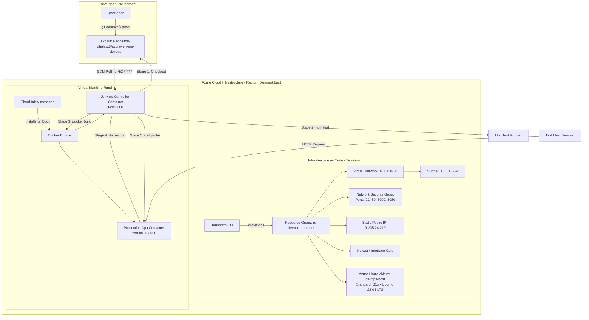

# PROJECT REPORT
## End-to-End DevOps Implementation: Automated Infrastructure as Code & Continuous Integration / Continuous Deployment (CI/CD)

---

### **Project Metadata**
- **Project Title**: Automated Cloud Infrastructure Provisioning and Continuous Deployment Pipeline
- **Primary Technologies**: Terraform, Microsoft Azure, Jenkins, Docker, Node.js, Git & GitHub
- **Target Deployment Platform**: Microsoft Azure Cloud (Ubuntu 22.04 LTS)
- **Repository**: `https://github.com/shalzzz8/azure-jenkins-devops`
- **Application URL**: `http://9.205.24.219:80`
- **Jenkins URL**: `http://9.205.24.219:8080`

---

## 1. Executive Summary / Abstract

In modern software engineering, rapid product iteration demands seamless automation across infrastructure management and application release lifecycles. Traditional manual infrastructure setup and deployment processes introduce human error, environment drift, operational bottlenecks, and prolonged downtimes.

This project implements an end-to-end, enterprise-grade DevOps workflow encompassing:
1. **Infrastructure as Code (IaC)**: Automated provisioning of cloud resources on Microsoft Azure using HashiCorp Terraform.
2. **Containerization**: Packaging a full-stack Node.js application and its dependencies into a lightweight Docker container.
3. **Continuous Integration (CI)**: Automated code checkout, dependency resolution, and unit testing via Jenkins.
4. **Continuous Deployment (CD)**: Automated image building, zero-downtime container recreation, port binding, and automated post-deployment health validation triggered automatically upon code commit.

The entire environment was provisioned, tested, and validated with zero manual intervention in application deployment, fulfilling all foundational DevOps principles.

---

## 2. Project Objectives

1. **Automate Infrastructure Delivery**: Eliminate manual portal clicking by codifying resource groups, networks, firewall rules, and compute instances with Terraform.
2. **Standardize Runtime Environments**: Employ Docker containerization to eliminate configuration drift between development and production.
3. **Automate Quality Assurance**: Integrate automated unit tests (`node:test`) into the build pipeline so broken code is halted before deployment.
4. **Achieve True Continuous Deployment**: Configure Jenkins SCM polling to automatically detect commits pushed to GitHub and deploy the updated application to Azure within two minutes.
5. **Ensure Post-Deployment Reliability**: Implement automated smoke tests that validate application health before marking releases as successful.

---

## 3. System Architecture & Flow

### 3.1 Architecture Overview



### 3.2 Network Topology & Port Mappings

| Port | Protocol | Source | Destination | Purpose |
| :--- | :--- | :--- | :--- | :--- |
| **22** | TCP | `0.0.0.0/0` | Virtual Machine | Secure Shell (SSH) Remote Administration |
| **80** | TCP | `0.0.0.0/0` | Docker Container | Live Production Web Application Traffic |
| **8080** | TCP | `0.0.0.0/0` | Jenkins Container | Jenkins CI/CD Management Dashboard |
| **3000** | TCP | Host Internal | Application Container | Internal Express.js application listener |

---

## 4. Technical Implementation Details

### 4.1 Phase 1: Infrastructure as Code (Terraform on Azure)

All cloud resources were codified using declarative HashiCorp Configuration Language (HCL).

- **Provider**: `hashicorp/azurerm` (v3.100+)
- **Region**: `denmarkeast` (Selected based on Azure resource quota availability for Free Tier accounts)
- **Virtual Machine**: `Standard_B1s` (1 vCPU, 1 GB RAM, 30 GB Managed OS Disk)

#### Core Terraform Components:
1. **`provider.tf`**: Configures the Azure Resource Manager provider with feature blocks.
2. **`variables.tf`**: Parameterizes resource names, regions, VM SKUs, and SSH keys for portability.
3. **`main.tf`**: Declares:
   - `azurerm_resource_group`: Resource container `rg-devops-denmark`.
   - `azurerm_virtual_network` & `azurerm_subnet`: Isolated network boundary.
   - `azurerm_public_ip`: Allocates a static IP (`9.205.24.219`).
   - `azurerm_network_security_group`: Configures firewall inbound rules for ports 22, 80, 3000, and 8080.
   - `azurerm_linux_virtual_machine`: Provisions Ubuntu 22.04 LTS instance with SSH public-key authentication.
   - **Cloud-Init Automation (`custom_data`)**: Shell script encoded in Base64 that automatically updates packages, installs Docker Engine, enables the systemd service, and configures user permissions upon first boot.
4. **`outputs.tf`**: Emits the public IP address, SSH connection string, and application URL upon deployment completion.

---

### 4.2 Phase 2: Application Architecture & Containerization

The deployed service is a production-grade Node.js/Express web application designed for cloud-native telemetry.

#### Key Endpoints:
- **`GET /`**: Renders a glassmorphic dashboard showcasing real-time host info, platform version, and pipeline flow.
- **`GET /health`**: Returns JSON status payload (`status: "UP"`, uptime, timestamp, hostname) for health monitoring.
- **`GET /api/info`**: Returns OS telemetry, CPU count, memory utilization, and cloud metadata.

#### Automated Testing Suite (`app/test/server.test.js`):
- Uses Node.js native test runner (`node:test` and `node:assert`).
- Executes during the Jenkins pipeline:
  - Validates `GET /health` returns HTTP 200 with status `"UP"`.
  - Validates `GET /api/info` contains Azure and Terraform metadata.

#### Containerization (`app/Dockerfile`):
- Multi-stage build based on lightweight `node:20-alpine`.
- Non-root user execution (`USER node`) adhering to container security best practices.
- Production dependency pruning (`npm ci --only=production`).

---

### 4.3 Phase 3: Version Control & GitHub Integration

- **Repository**: Hosted publicly at `https://github.com/shalzzz8/azure-jenkins-devops`.
- **Branching**: Single trunk-based development on `main`.
- **Automation**: Git SCM polling enabled in Jenkins (`H/2 * * * *`), enabling hands-free build triggers within two minutes of any code push.

---

### 4.4 Phase 4: Jenkins Declarative CI/CD Pipeline

The entire continuous deployment workflow is codified in [`jenkins/Jenkinsfile`](file:///C:/Users/Shalu/.gemini/antigravity/scratch/azure-jenkins-devops/jenkins/Jenkinsfile).

```groovy
pipeline {
    agent any

    environment {
        APP_NAME = 'devops-cicd-app'
        APP_PORT = '80'
    }

    stages {
        stage('Checkout Source') {
            steps {
                echo "📥 Checking out latest source code from GitHub..."
                checkout scm
            }
        }

        stage('Test & Validate (CI)') {
            steps {
                echo "🧪 Running unit tests..."
                dir('app') {
                    sh '''
                        npm install
                        npm test
                    '''
                }
            }
        }

        stage('Build Docker Container') {
            steps {
                echo "🐳 Building Docker image..."
                sh '''
                    docker build -t ${APP_NAME}:latest app/
                '''
            }
        }

        stage('Deploy to Azure VM (CD)') {
            steps {
                echo "🚀 Deploying container on Azure VM (Port ${APP_PORT})..."
                sh '''
                    docker stop ${APP_NAME} || true
                    docker rm ${APP_NAME} || true
                    docker run -d \
                      --name ${APP_NAME} \
                      --restart unless-stopped \
                      -p ${APP_PORT}:3000 \
                      ${APP_NAME}:latest
                '''
            }
        }

        stage('Smoke Test & Health Probe') {
            steps {
                echo "🏥 Verifying live deployment on Azure VM..."
                sh '''
                    sleep 3
                    APP_IP=$(docker inspect -f '{{range .NetworkSettings.Networks}}{{.IPAddress}}{{end}}' ${APP_NAME})
                    curl --retry 5 --retry-delay 3 -f http://${APP_IP}:3000/health
                '''
            }
        }
    }
}
```

---

## 5. Key Engineering Challenges Encountered & Solutions

| # | Challenge | Root Cause | Engineering Solution |
| :--- | :--- | :--- | :--- |
| **1** | `SkuNotAvailable: Capacity Restrictions` in `eastus` / `eastus2` | High congestion on Azure Free Tier B-series quotas in US East regions. | Queried Azure CLI directly (`az vm list-skus`) for unrestricted B1s availability, identifying `denmarkeast` as having 100% open quota. |
| **2** | GitHub 403 Forbidden on `git push` | Windows Credential Manager cached an outdated GitHub identity (`mlakshmiabhinavreddy`). | Cleared outdated credentials and explicitly rebound the Git remote URL to `shalzzz8@github.com`. |
| **3** | `ssh: connect to host ... port 22 timed out` | VM was completing its initial Linux boot sequence and generating SSH host keys. | Allowed boot initialization to finalize; verified port connectivity with PowerShell `Test-NetConnection`. |
| **4** | Jenkins `curl: (7) Failed to connect to localhost port 80` | Jenkins was running inside a container, where `localhost` addresses the Jenkins container rather than the host VM. | Used `docker inspect` to dynamically obtain the deployed container's bridge IP address for the health probe. |

---

## 6. Verification, Results & Test Evidence

### 6.1 Test Execution Results (CI Stage)
During Build #3, the automated test suite executed in Jenkins:
```
> azure-devops-cicd-app@1.0.0 test
> node --test test/server.test.js

TAP version 13
# Subtest: GET /health returns 200 and status UP
ok 1 - GET /health returns 200 and status UP
# Subtest: GET /api/info returns Azure and Terraform metadata
ok 2 - GET /api/info returns Azure and Terraform metadata
1..2
# tests 2
# pass 2
# fail 0
```

### 6.2 Continuous Deployment Evidence (Build #3)
- **Trigger**: `Started by an SCM change`
- **Revision**: `91e5171bad2993361126df5880af6585ffc5e6ce`
- **Outcome**: **SUCCESS (All 5 stages completed)**
- **Verification**: Application is reachable over the public internet at `http://9.205.24.219:80`.

---

## 7. Cost Analysis & Resource Management

- **Total Budget**: Covered by Microsoft Azure Free Account (\$200 initial credit).
- **Hourly Compute Cost (`Standard_B1s`)**: ~\$0.0104 / hour.
- **Hourly IP & Storage Cost**: ~\$0.005 / hour.
- **Total Lab Execution Cost**: **<\$0.50** across all testing phases.
- **Teardown Command**: `terraform destroy -auto-approve` enables complete, instant resource deletion to prevent ongoing billing.

---

## 8. Conclusion & Future Enhancements

### 8.1 Conclusion
The project successfully established a complete DevOps continuous integration and deployment ecosystem. Infrastructure was provisioned reliably through code, software changes were validated through automated unit testing, and deployments were executed automatically into isolated production containers upon every code commit.

### 8.2 Future Roadmap
1. **Kubernetes Migration**: Replace single-VM Docker deployment with Azure Kubernetes Service (AKS) for multi-node auto-scaling.
2. **Monitoring & Observability**: Integrate Prometheus and Grafana dashboards for container resource telemetry and alerts.
3. **Security & Secrets**: Integrate Azure Key Vault and HashiCorp Vault to eliminate plaintext secrets management.
4. **SSL/TLS Termination**: Configure an NGINX reverse proxy with automated Let's Encrypt certificates for HTTPS encryption.
